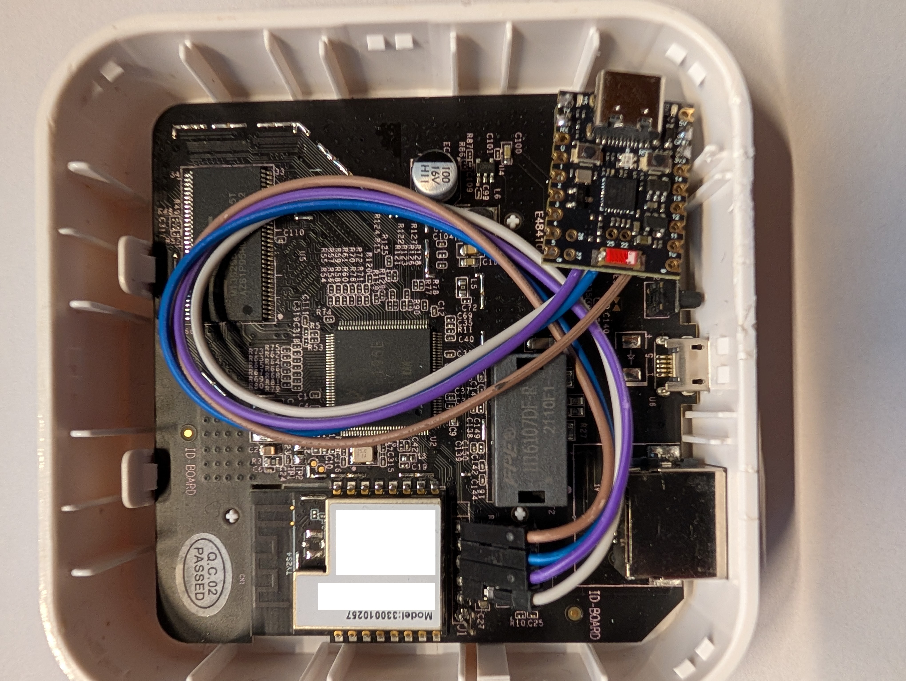
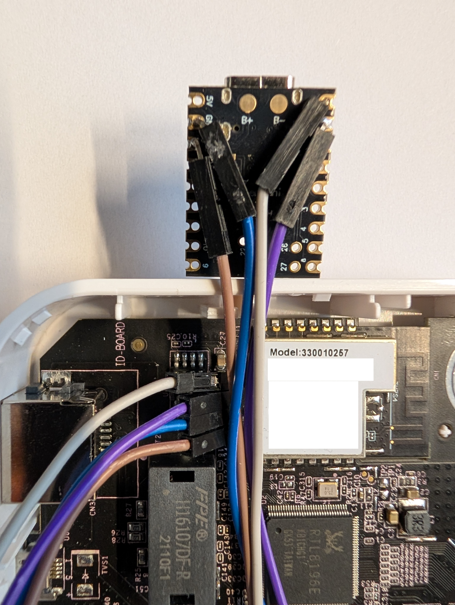

# Add an ESP32-H2 Thread radio to a Silvercrest TYGWZ1

**README v1 — working draft — 21 October 2026**

This guide adds a separate Thread radio to a Lidl Silvercrest TYGWZ1 / RTL8196E running jnilo1's Open Linux Firmware. The existing EFR32 provides Zigbee on TCP **8888**. An ESP32-H2 running OpenThread RCP firmware uses the freed console UART **ttyS0**, exposed on TCP **8889**. Home Assistant runs OTBR.

Follow the upstream documentation for standard installation, radio flashing, building and upgrades. This README focuses on the additional changes and their order.

The original target is project release **v4.7.0**, not Linux kernel version 4.7.0. Record the release and commit actually used. Release-specific build and flash commands have not been verified in this draft; links to main may change.  
  
## 1. Prepare an Ubuntu machine or a temporary VM

### Prerequisites

- Ubuntu matching the version supported by the upstream build instructions for the selected revision (currently documented as Ubuntu 22.04).
- **At least 8 GB RAM.** This is the prerequisite selected for this guide; a successful complete build with 8 GB has not yet been verified. A previous attempt with 4 GB failed with Error 137, whose cause was not confirmed. The next test machine was increased to 16 GB.
- **100 GB virtual disk.** Verify that the root logical volume/filesystem actually uses the intended capacity; Ubuntu may leave part of the disk unallocated inside LVM.
- A bridged network adapter on the **same VLAN and IP subnet as the Silvercrest gateway**, with an unused temporary bootloader/TFTP address.
- Disk-backed temporary build storage as described below; a small RAM-backed /tmp is insufficient for this setup.

If you do not already have a suitable Ubuntu machine on the gateway's network, create a dedicated VM for this project. This keeps the tools in one place and lets you remove the VM when the work is complete. Save your source changes, firmware images and backups elsewhere before deleting it.

Use the Ubuntu version supported by the upstream [Build Environment README](https://github.com/jnilo1/rtl8196e-gateway/blob/main/1-Build-Environment/README.md) for your selected revision, rather than automatically choosing the latest release. The currently documented native build environment uses Ubuntu 22.04.

Configure the VM's network adapter in **bridged mode** and place it on the **same VLAN and IP subnet as the Silvercrest** for the upstream flashing procedure. This provides direct network access for firmware transfers, including TFTP; using NAT alone is not the documented VM setup. Follow the upstream network and firewall prerequisites.

If you use the TTL adapter from inside the VM, pass the USB adapter through to the guest and verify serial access before continuing.

### Check the actual root filesystem size

A 50 GB virtual disk does not necessarily provide a 50 GB root filesystem. In this installation Ubuntu allocated only 24 GB to the root logical volume. After moving /tmp to disk, the toolchain build filled that filesystem and failed while installing GCC with **No space left on device**. Inode usage was only 50%; the failure was exhausted data space.

Before building, inspect:

~~~sh
lsblk
sudo vgs
sudo lvs
df -h / /tmp
~~~

If the volume group has unallocated space, extend the root logical volume/filesystem using the appropriate procedure for your layout. If it does not, enlarge the VM disk and storage layers as needed. Do not assume the advertised VM disk size equals available build space. Keep room for source archives, extracted sources, intermediate compiler builds and retained failed attempts. A successful full toolchain build and its peak space usage have not yet been recorded for this setup.

Do not retry a build on a full filesystem. Preserve useful logs and source changes before cleaning failed build directories; inspect their sizes and identify each target before deletion.

### Check temporary build storage

Before starting the upstream build environment installation, check where temporary files will be stored:

~~~sh
df -h /tmp
df -i /tmp
findmnt -no OPTIONS /tmp
~~~

Do not assume that /tmp has access to the VM's disk space. In our Ubuntu VM, the root filesystem had 16 GB free, but /tmp was a separate **821 MB tmpfs** with **usrquota** enabled. The toolchain installation failed with:

~~~text
/tmp/crosstool-ng-install/share/crosstool-ng/scripts/functions: line 300: printf: write error: Disk quota exceeded
~~~

At the time, /tmp was only 80% full and inode usage was 4%. Per-user quotas can cause a write to fail before the entire filesystem is full; the exact quota limit was not measured in this case.

If /tmp is a small tmpfs, use disk-backed temporary storage for this dedicated build VM. **Wait for the failed installer to stop**, then run:

~~~sh
sudo mkdir -p /var/tmp/build-tmp
sudo chmod 1777 /var/tmp/build-tmp
sudo mount --bind /var/tmp/build-tmp /tmp
df -h /tmp
~~~

Confirm that /tmp now shows the disk-backed filesystem and sufficient free space. Then retry the upstream installation from the repository's 1-Build-Environment directory:

~~~sh
sudo ./install_deps.sh
~~~

This bind mount is temporary and disappears after reboot. It hides rather than deletes the original tmpfs contents. Apply it while the VM is otherwise idle; existing temporary files become inaccessible through /tmp while the mount is active. If you reboot before building, check /tmp again and reapply the workaround if needed. Verified on a fresh, updated Ubuntu installation: after applying this disk-backed /tmp workaround, sudo ./install_deps.sh completed successfully.

## 2. Install Open Linux Firmware and get Zigbee working

1. Flash the Silvercrest with Open Linux Firmware following the upstream [Getting Started guide](https://jnilo1.github.io/rtl8196e-gateway/docs/getting-started/). Follow its safety, backup and recovery instructions.
2. Flash the EFR32 Zigbee radio following the same guide.
3. Configure your Zigbee integration to use TCP **8888**, and migrate your Zigbee devices using the procedure appropriate for your current installation.
4. Verify reliable operation of your Zigbee devices.
5. Keep the console connected through a **3.3 V TTL UART adapter** and confirm that it still works.

**Checkpoint:** A working Linux/Zigbee gateway with a working serial console. Do not connect the H2 yet.

## 3. Prepare the build environment

1. Clone the repository:

~~~sh
git clone https://github.com/jnilo1/rtl8196e-gateway.git
cd rtl8196e-gateway
~~~

2. Select and record the intended release/commit before editing. Do not assume the current main branch matches the installed release.
3. Follow the upstream [Build Environment README](https://github.com/jnilo1/rtl8196e-gateway/blob/main/1-Build-Environment/README.md), using documentation from your selected revision where available.
4. Confirm network administration and the recovery procedure are available before removing serial console access.

### Verify the native build environment before editing firmware

After completing upstream [Native setup](https://github.com/jnilo1/rtl8196e-gateway/blob/main/1-Build-Environment/README.md#native-setup), run these checks from the repository root as your normal user. Do not treat the presence of x-tools or a successful fullflash image assembly as proof that the compiler is installed.

#### Check the compiler and binary utilities

~~~sh
TOOLCHAIN="$PWD/x-tools/mips-lexra-linux-musl/bin"
export PATH="$TOOLCHAIN:$PATH"

command -v mips-lexra-linux-musl-gcc
mips-lexra-linux-musl-gcc --version
mips-lexra-linux-musl-gcc -dumpmachine
mips-lexra-linux-musl-ld --version
mips-lexra-linux-musl-objcopy --version
~~~

Every command must succeed. The target reported by -dumpmachine must be mips-lexra-linux-musl. A directory containing only tools such as as, ld and objcopy is an incomplete installation: GCC must also be present and runnable.

#### Compile and link a small target program

This checks the compiler, assembler, linker and target C library together. It does not validate the complete firmware build or Lexra-specific runtime behavior.

~~~sh
CHECK_DIR=$(mktemp -d /var/tmp/lexra-check.XXXXXX)
printf '%s\n' 'int main(void) { return 0; }' > "$CHECK_DIR/check.c"

if mips-lexra-linux-musl-gcc "$CHECK_DIR/check.c" -o "$CHECK_DIR/check"; then
    mips-lexra-linux-musl-readelf -h "$CHECK_DIR/check"
    echo "PASS: target program compiled and linked"
else
    echo "FAIL: stop and fix the toolchain before continuing"
fi
~~~

Expect an ELF32 MIPS executable. Do not run it on the Ubuntu host: it is built for the target architecture. If this fails, stop here. The small test directory is retained for inspection.

#### Check host tools and temporary storage

~~~sh
for tool in make gcc patch bison flex fakeroot mkfs.jffs2 mksquashfs tftp; do
    if command -v "$tool" >/dev/null 2>&1; then
        printf 'OK: %s\n' "$tool"
    else
        printf 'MISSING: %s\n' "$tool"
    fi
done

df -h /tmp
df -i /tmp
~~~

Resolve every missing tool before proceeding. These checks cover the main RTL8196E build/packaging prerequisites; they do not replace upstream's full dependency list. Keep using the disk-backed /tmp arrangement described in step 1 for this VM. The definitive check is a successful source build of the required firmware components.

#### Silicon Labs tools: resolve download failures before declaring setup complete

The fresh installation successfully produced Lexra GCC 15.2.0 (crosstool-NG 1.28.0.3_a3fef85) and the Realtek tools. It then failed downloading slc-cli: the public URL in install_silabs.sh returned HTTP 403 from Akamai. This does not establish the reason for the rejection.

Silicon Labs' [official SLC installation instructions](https://docs.silabs.com/simplicity-studio-5-users-guide/5.10.0/ss-5-users-guide-tools-slc-cli/02-installation) link to a different Linux download path:

https://www.silabs.com/documents/login/software/slc_cli_linux.zip

**Unresolved download issue:** The official login URL also returned HTTP 403 from curl on Ubuntu, including with an Edge-style User-Agent. Downloading through Edge on Windows succeeded. Changing the User-Agent alone did not resolve the rejection; the roles of cookies, network address, TLS handling or server-side filtering remain unconfirmed. Recheck this issue before declaring the native setup fully reproducible. Do not present a User-Agent override as a verified fix.

**Temporary procedure:** Download the Linux ZIP through the official link in the Windows browser and copy it to the Ubuntu build machine. For example, from Windows PowerShell, replace UBUNTU_IP with the build machine's address:

~~~powershell
scp "$env:USERPROFILE\Downloads\slc_cli_linux.zip" sysadmin@UBUNTU_IP:/var/tmp/
~~~

On Ubuntu, validate the copied archive and inspect its top-level paths before installing:

~~~sh
unzip -t /var/tmp/slc_cli_linux.zip
unzip -Z1 /var/tmp/slc_cli_linux.zip | head -20
~~~

The ZIP test must pass. Verify the archive layout before extracting it into the project's silabs-tools directory; an HTML login/error response is not a tool archive. The Windows browser download and transfer of the SLC archive were reported; the installer subsequently progressed to the Commander download. The subsequent installer retry finished with SETUP COMPLETE after Commander was installed manually.

The inspected project installer skips its SLC download when silabs-tools/slc_cli/slc already exists. A manual installation must reproduce that expected layout and executable permissions, then the upstream installer must be rerun to finish the remaining Silicon Labs dependencies. Record the SLC version and validate it against the project's SDK requirements before marking this part complete.

**Commander download:** The installer subsequently failed to download Commander as well. The owner downloaded **SimplicityCommander-Linux.zip** on Windows, transferred it to Ubuntu with scp, and extracted it following the commands and expected layout in **1-Build-Environment/12-silabs-toolchain/install_silabs.sh**. Use that script from the selected repository revision as the reference for archive paths and nested extraction; do not assume that simply unzipping the outer archive completes installation. The exact HTTP response for the Commander failure was not captured.

After manually installing the downloaded tools, rerun the installer:

~~~sh
cd ~/rtl8196e-gateway/1-Build-Environment
sudo ./install_deps.sh
~~~

**Confirmed result:** After manually downloading and installing SLC and Commander, the repeated sudo ./install_deps.sh finished with SETUP COMPLETE. The native installer has now completed successfully on the fresh machine. Individual tool checks and firmware builds remain separate validation steps.

EFR32 firmware updates using upstream prebuilt images and rebuilding EFR32 firmware from source are separate workflows. The guide must retain both upstream paths; a successful Linux-only build does not validate the EFR32 toolchain or radio update procedure.

#### If the toolchain is incomplete

The observed installation contained binutils but no GCC. The standalone toolchain builder then skipped rebuilding because its destination directory already existed.

1. Confirm GCC is actually missing before moving anything.
2. Preserve the incomplete directory under another name:

~~~sh
mv x-tools/mips-lexra-linux-musl \
   "x-tools/mips-lexra-linux-musl.incomplete-$(date +%Y%m%d-%H%M%S)"
~~~

3. If ct-ng is not in PATH but the installer placed it under /tmp, check it and expose it to the current shell:

~~~sh
ls -l /tmp/crosstool-ng-install/bin/ct-ng
export PATH="/tmp/crosstool-ng-install/bin:$PATH"
ct-ng version
~~~

This path is specific to the observed installation and may disappear after reboot. If ct-ng is absent, repair its installation using upstream instructions rather than assuming this PATH change is sufficient.

4. In the observed setup, downloading musl from www.musl-libc.org failed during TLS negotiation. Downloading the same release from musl.libc.org succeeded. If you encounter that same failure, change the project's download mirror:

~~~sh
sed -i \
  's|https://www.musl-libc.org/releases|https://musl.libc.org/releases|g' \
  1-Build-Environment/10-lexra-toolchain/crosstool-ng.config
~~~

Keep TLS and checksum verification enabled. The alternative musl download succeeded. A later fresh-install run produced working Lexra GCC 15.2.0 and ultimately completed the native installer; whether the mirror change was required in that final run was not recorded.

5. Build the toolchain as your normal user:

~~~sh
cd 1-Build-Environment/10-lexra-toolchain
./build_toolchain.sh
~~~

On failure, inspect build.log in the retained build directory. If another attempt creates an incomplete destination, check it before retrying: the builder may otherwise skip it again. After a successful build, return to the repository root and repeat all checks above.

**Checkpoint:** GCC runs, the target program compiles and links, the required host tools are found, and temporary storage has sufficient space. Only then continue with firmware source edits and compilation.

## 4. Apply the Linux 6.18 changes

All source edits below use sed. Run them from the repository root on a clean checkout of the selected revision. Copy commands must run only once: their destination directories/files must not already exist. Do not rerun the whole sequence over an existing modified tree.

These commands follow the recovered 6.18 source and patch layout. sed does not fail when a search pattern is missing, so review the final diff before building. Record the repository commit; the original installation's exact commit is still unknown.

### Set the paths

~~~sh
P=3-Main-SoC-Realtek-RTL8196E
KERNEL_SRC="$P/32-Kernel"
BASE="$KERNEL_SRC/files-6.18/drivers/net"
DTS="$KERNEL_SRC/files-6.18/arch/mips/boot/dts/realtek/rtl8196e.dts"
PATCHES="$KERNEL_SRC/patches-6.18"
INIT="$P/34-Userdata/skeleton/etc/init.d"
~~~

Keep the same shell open for the following commands.

### Disable the Linux console and serial login

Replace the console boot argument without changing the root filesystem arguments, then remove the ttyS0 getty entry:

~~~sh
sed -i 's/console=ttyS0,38400/console=null/' "$DTS"
sed -i '\|^ttyS0::respawn:/sbin/getty -L 38400 ttyS0 vt100$|d' \
  "$P/33-Rootfs/skeleton/etc/inittab"
~~~

This removes both Linux console use and the login process from ttyS0. It does not silence the bootloader. The recovered 7.2 experiment is not part of this 6.18 procedure.

### Copy and modify the bridge driver

Retain the original Zigbee bridge and create a separate driver for H2:

~~~sh
cp -a "$BASE/rtl8196e-uart-bridge" "$BASE/rtl8196e-uart-bridge2"
mv "$BASE/rtl8196e-uart-bridge2/rtl8196e_uart_bridge_main.c" \
   "$BASE/rtl8196e-uart-bridge2/rtl8196e_uart_bridge2_main.c"

sed -i \
  -e 's/rtl8196e-uart-bridge"/rtl8196e-uart-bridge2"/g' \
  -e 's|"/dev/ttyS1"|"/dev/ttyS0"|g' \
  -e 's/rtl_port[[:space:]]*=[[:space:]]*8888;/rtl_port = 8889;/' \
  -e 's/rtl_baud[[:space:]]*=[[:space:]]*[0-9][0-9]*;/rtl_baud = 115200;/' \
  -e 's/rtl_flow_control[[:space:]]*=[[:space:]]*BRIDGE_FC_HW;/rtl_flow_control = 0;/' \
  -e 's/rtl_nrst_gpio[[:space:]]*=[[:space:]]*12;/rtl_nrst_gpio = -1;/' \
  -e 's/"uart-bridge-client"/"uart-bridge2-client"/g' \
  -e 's/port (default 8888)/port (default 8889)/' \
  -e 's/echo uart-bridge-client/echo uart-bridge2-client/' \
  "$BASE/rtl8196e-uart-bridge2/rtl8196e_uart_bridge2_main.c"
~~~

This assigns ttyS0, TCP 8889 and 115200 baud; disables flow control and the EFR32 reset GPIO; and gives bridge2 separate driver, LED-trigger and device-tree lookup names. No H2 reset GPIO is assigned. The driver changes have been compared against the expected diff on the new installation; image assembly succeeded, but the first upgrade still used the unmodified kernel; the subsequent explicit kernel build and upgrade successfully armed both bridges.

### Give bridge2 its own build configuration

Rename the copied Kconfig symbol and the object names in its Makefile:

~~~sh
sed -i \
  -e 's/^config RTL8196E_UART_BRIDGE$/config RTL8196E_UART_BRIDGE2/' \
  -e 's/Realtek RTL8196E in-kernel/Realtek RTL8196E second in-kernel/' \
  "$BASE/rtl8196e-uart-bridge2/Kconfig"

sed -i \
  -e 's/CONFIG_RTL8196E_UART_BRIDGE)/CONFIG_RTL8196E_UART_BRIDGE2)/g' \
  -e 's/rtl8196e_uart_bridge/rtl8196e_uart_bridge2/g' \
  "$BASE/rtl8196e-uart-bridge2/Makefile"
~~~

Run the Makefile substitution only once on the original copy; a repeat would produce bridge22 object names.

Add bridge2 to the existing kernel patches. The hunk-header substitutions below match the recovered patch versions; check the resulting patches if upstream has changed:

~~~sh
sed -i \
  -e 's/^@@ -514,6 +514,8 @@/@@ -514,6 +514,9 @@/' \
  -e '/^+source "drivers\/net\/rtl8196e-uart-bridge\/Kconfig"$/a\
+source "drivers/net/rtl8196e-uart-bridge2/Kconfig"' \
  "$PATCHES/drivers-net-Kconfig.patch"

sed -i \
  -e 's/^@@ -54,6 +54,7 @@/@@ -54,6 +54,8 @@/' \
  -e '/^+obj-$(CONFIG_RTL8196E_UART_BRIDGE) += rtl8196e-uart-bridge\/$/a\
+obj-$(CONFIG_RTL8196E_UART_BRIDGE2) += rtl8196e-uart-bridge2/' \
  "$PATCHES/drivers-net-Makefile.patch"

sed -i '/^CONFIG_RTL8196E_UART_BRIDGE=y$/a\
CONFIG_RTL8196E_UART_BRIDGE2=y' \
  "$KERNEL_SRC/config-6.18-realtek.txt"
~~~

The original bridge remains enabled. Both bridge2 Makefile entries now use CONFIG_RTL8196E_UART_BRIDGE2. This corrects the recovered implementation, which used the original bridge symbol in both places; the new build has now run on the gateway and both bridges armed successfully.

### Create the startup script

Copy the original startup file, preserving its permissions, then replace its contents using sed:

~~~sh
cp -a "$INIT/S50uart_bridge" "$INIT/S51uart_bridge2"

sed -i '1,$c\
#!/bin/sh\
\
PARAMS=/sys/module/rtl8196e_uart_bridge2/parameters\
\
case "$1" in\
    start)\
        [ -d "$PARAMS" ] || exit 1\
        echo 0 > "$PARAMS/flow_control"\
        echo 1 > "$PARAMS/enable"\
        ;;\
    stop)\
        [ -d "$PARAMS" ] || exit 0\
        echo 0 > "$PARAMS/enable"\
        ;;\
    restart)\
        "$0" stop && "$0" start\
        ;;\
    *)\
        echo "Usage: $0 {start|stop|restart}"\
        exit 1\
        ;;\
esac\
\
exit 0' "$INIT/S51uart_bridge2"

chmod +x "$INIT/S51uart_bridge2"
~~~

The script uses the driver's compiled ttyS0/115200/8889 defaults, disables flow control and enables bridge2. It does not read or alter the original EFR32 radio configuration. Its contents match the recovered startup script.

### Review and compile

~~~sh
git diff --check
git diff -- . ':!*.img'
git status --short

cat "$BASE/rtl8196e-uart-bridge2/Kconfig"
cat "$BASE/rtl8196e-uart-bridge2/Makefile"
sh -n "$INIT/S51uart_bridge2"

diff -u \
  "$BASE/rtl8196e-uart-bridge/rtl8196e_uart_bridge_main.c" \
  "$BASE/rtl8196e-uart-bridge2/rtl8196e_uart_bridge2_main.c"
~~~

The last command is expected to report differences. New untracked files are not included in ordinary git diff, so review the copied driver files and startup script as well. Ensure no unrelated changes were introduced.

### Build from source before assembling the flash image

**build_fullflash.sh assembles existing component images; it does not compile the modified kernel sources.** The initial attempt ran build_fullflash.sh followed by flash_install_rtl8196e.sh. The new startup script was installed, but the running kernel still had console=ttyS0,38400 and no bridge2 module. Successful image assembly must not be recorded as successful source compilation.

**Mandatory step:** From the repository root, explicitly compile the modified kernel before image assembly and upgrade:

~~~sh
BOARD=lidl KERNEL=6.18 ./3-Main-SoC-Realtek-RTL8196E/32-Kernel/build_kernel.sh
~~~

This direct kernel build was the missing step in the initial attempts. After compiling the kernel and repeating the full upgrade, both bridges armed successfully on the gateway. Stop on any build error and confirm that the new Lidl kernel image has been written before upgrading. The full image also needs the modified rootfs skeleton and userdata startup script; kernel compilation alone does not install them. Follow the upstream full-upgrade packaging procedure.

Record the build command and git rev-parse HEAD / git describe --tags --always --dirty for reproducibility.

**Verified upgrade result:** S51uart_bridge2 was installed and executable under /userdata/etc/init.d. The initial failure was therefore not a missing startup script; the running kernel did not contain bridge2.

After upgrading, run these checks **on the gateway**:

~~~sh
ls -l /userdata/etc/init.d/S51uart_bridge2
sh -n /userdata/etc/init.d/S51uart_bridge2
cat /proc/cmdline
ls /sys/module/rtl8196e_uart_bridge2/parameters
cat /sys/module/rtl8196e_uart_bridge2/parameters/armed
~~~

Confirm the script is executable, console=null is present, bridge2 parameters exist and armed is 1. Also verify that Zigbee still works on TCP 8888. A missing script after a kernel/rootfs-only update does not establish a driver fault: that update does not install the new userdata script.

### Confirmed gateway result

After the explicit kernel build and full upgrade, the gateway reported:

~~~text
[   13.179440] rtl8196e-uart-bridge: armed on /dev/ttyS1 @ 115200 baud, listening on 0.0.0.0:8888
[   13.335480] rtl8196e-uart-bridge2: armed on /dev/ttyS0 @ 115200 baud, listening on 0.0.0.0:8889
~~~

This confirms that both drivers initialized and armed with the intended UARTs, baud rate and TCP ports. It does not by itself confirm console removal, Zigbee device communication, H2 RCP communication or Matter operation; verify those separately.

## 5. Upgrade and verify the freed UART

### Check the temporary bootloader/TFTP address first

In the upgrade setup used here, the temporary bootloader/TFTP address is **x.x.x.6** on the selected network. This is separate from the gateway's normal Linux address, here 10.36.5.251. Confirm the actual bootloader address shown by your installer before proceeding; do not infer it from the Linux address alone.

**The temporary address must be free before the gateway enters bootloader mode.** If another device already uses x.x.x.6, the upgrade can fail or contact the wrong device. Check your DHCP leases/reservations, static-address records and the network itself. A missing ping response alone does not prove the address is unused.

Reserve/exclude the intended address from conflicting assignments, or select another free bootloader address using the options supported by your upstream revision. The inspected installer supports --boot-ip; check its local --help before using it. Keep the build VM on the same VLAN/subnet with bridged networking.

1. Install the modified firmware using the upstream **Upgrade** procedure/example referenced by the project and build documentation for your selected release.
2. Keep the TTL adapter connected while verifying the result.
3. Confirm that the gateway boots and remains accessible over the network.
4. Verify that Zigbee still works on TCP **8888**.
5. Observe the serial output during boot and after Linux starts. Confirm that Linux no longer writes console messages and that no login prompt appears. Check the running kernel command line and confirm that getty is absent.

The former console is **ttyS0** (serial UART zero), not Linux's /dev/tty0 virtual terminal.

Some bootloader output may remain before Linux starts: console=null does not change the bootloader. Record any remaining output and assess its effect before connecting the H2. Ongoing Linux messages or a login prompt mean the UART is not ready for RCP traffic.

**Checkpoint:** The modified gateway boots, Zigbee works, and ttyS0 is free of Linux console/getty traffic.

**Not yet recorded:** Exact custom-image filename and upgrade invocation. Use the upstream procedure rather than a guessed flash command.

## 6. Prepare the ESP32-H2

1. Flash the H2 over USB with OpenThread **RCP** firmware. The original setup used a standard Thread radio example.
2. Configure its transport UART for **115200 baud without hardware flow control**.
3. Verify the UART pins and serial framing. Keep debug/log output off the RCP transport UART.
4. Record the board model, example name, SDK version/commit, GPIO assignments and configuration.

**Not yet recorded:** Exact example, build/USB flash commands and GPIO numbers. Establish these for the selected board and firmware.

**Observed limitation:** 460800 baud caused communication errors in the original setup; 115200 was used instead. The cause is unknown. The existing Zigbee baud rate was also recalled as 115200 but requires verification.

## 7. Wire the H2 and configure TCP 8889

1. Disconnect power before changing wiring. Disconnect the TTL console adapter before connecting the H2.
2. Verify the actual ttyS0 pads and H2 RCP UART pins. Use **3.3 V logic**, not RS-232 or 5 V UART.
3. Connect gateway TX to H2 RX, gateway RX to H2 TX, and common GND. RTS/CTS is not used.
4. Provide a suitable, verified power supply. Avoid backfeeding if USB and gateway power are both present.
5. Configure a persistent, transparent serial-to-TCP bridge:

| Setting | Value |
| --- | --- |
| UART | /dev/ttyS0 |
| Baud rate | 115200 |
| Hardware flow control | Disabled |
| TCP port | 8889 |

6. Retain the existing EFR32 Zigbee bridge on TCP **8888**.

The bridge2 driver defaults and S51uart_bridge2 startup script are documented in step 4. After upgrading, verify that the script exists and is executable under /userdata/etc/init.d, then confirm bridge2 is armed and listening on TCP 8889.

Restrict radio ports to trusted local systems and use one active client per radio.

### Installation photos

Overview of the ESP32-H2 placement and cable routing inside the original enclosure.

Close-up of the connections with the H2 board lifted out for visibility. These photos document the physical installation; use the verified board pinouts and TX/RX/GND connection instructions above to identify signals. Wire colours alone do not establish pin functions or supply voltage.

## 8. Add OTBR to Home Assistant

Install the OpenThread Border Router add-on. The original setup used:

~~~yaml
device: /dev/ttyS3
baudrate: '115200'
flow_control: false
otbr_log_level: info
firewall: true
nat64: false
beta: false
network_device: 10.36.5.251:8889
~~~

1. Ensure the gateway has the expected address, here **10.36.5.251**.
2. Save the configuration and start OTBR.
3. Check its log for connection to the network RCP and successful radio initialization without repeated resets.
4. Configure HA's Thread integration and select the intended Thread network.
5. Test a known Thread device, then repeat after restarting both the gateway and OTBR.
6. Verify simultaneous Zigbee and Thread operation.

/dev/ttyS3 is reproduced from the original HA configuration; it is not the gateway UART. Verify that your installed add-on uses network_device and actually connects to TCP **8889**.

The original discussion reported an ESPHome-based H2 device using Thread. Its exact firmware and test coverage were not recorded.

## 9. Add Matter later

Once Thread is stable, configure HA's Matter functionality and test an actual Matter-over-Thread device separately. Check IPv6, local discovery and commissioning access as needed for your network.

**Matter had not yet been tested in the original setup.** Working Thread communication alone does not confirm Matter operation.

## Troubleshooting

| Symptom | Check |
| --- | --- |
| Errors at 460800 | Use 115200 on H2, gateway bridge and OTBR, without hardware flow control. |
| Linux output or login prompt on ttyS0 | DTS boot arguments, running kernel command line, getty removal and other serial logging services. |
| Only bootloader output remains | Distinguish it from Linux output and assess its effect on H2 startup. |
| TCP 8889 is unreachable | Gateway address, bridge startup, local network access and another client occupying the port. |
| TCP connects but RCP initialization fails | RCP firmware, pins, crossed TX/RX, GND, baud rate, framing, flow control and power. |
| Zigbee stops working | EFR32 firmware/configuration, TCP 8888 and unintended changes to its bridge. |
| Works until reboot | Persistent bridge settings, service startup and reconnection behavior. |
| Thread works but Matter does not | Matter commissioning, credentials, IPv6 and discovery. |

## References

- [Upstream Getting Started](https://jnilo1.github.io/rtl8196e-gateway/docs/getting-started/)
- [Upstream Build Environment README](https://github.com/jnilo1/rtl8196e-gateway/blob/main/1-Build-Environment/README.md)
- [Upstream repository](https://github.com/jnilo1/rtl8196e-gateway)

Setup observations and HA settings come from the original private discussion. Unrecorded commands remain explicitly marked above.
